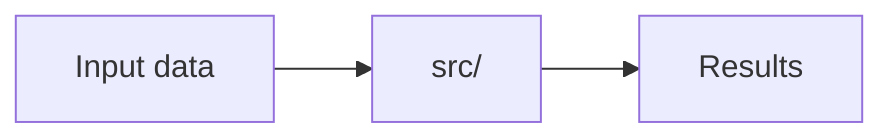

# iniciar-repo-ia

Leaves a Python and Artificial Intelligence repository (or multi-repo workspace) ready to work with **OpenCode**, **DeepSeek**, **`uv`**, **Engram**, **GGA**, and **ODD**. Runs in the current directory.

- **Idempotent:** if a step is already done, skip it. Never overwrite an existing file: show it and ask whether to complete it or leave it as-is.
- **With confirmation:** creating the GitHub remote, making the initial commit, and pushing require confirmation before execution. Everything else runs without asking.
- **Hard environment constraints:**
  - All Python environment management, dependency installation, and execution use **`uv`** (`uv init`, `uv add`, `uv sync`, `uv run`). **Never use `pip install`, `conda`, `poetry`, or `requirements.txt`.**
  - **Never use Jupyter Notebooks (`.ipynb`)** or notebook dependencies (`jupyter`, `ipykernel`, `notebook`). All source code lives in Python modules under `src/` and tests under `tests/`.
  - All code identifiers, types, docstrings, comments, and test names are written in **English**.

## 1. Project inputs

Extract whatever is already provided in the user's request and ask for the missing items in **a single message**:

- **Project name.** From this derive:
  - The *slug* (lowercase and hyphens, no spaces: `Embedding Service` → `embedding-service`), used by Engram, the directory, and the GitHub repo.
  - The Python *package* name (lowercase and underscores: `embedding_service`), located at `src/<package>/`.
- **What it is**, in one or two lines.
- **Type:**
  - *Standalone repo* (default).
  - *Repo inside a workspace:* the parent directory groups multiple repos for a single product. Runs inside the repo; if the root does not yet have `AGENTS.md` or `.engram/`, this skill creates them (steps 4 and 5).
  - *Workspace with existing repos:* runs at the workspace root.
- **Remote:** does it already exist? If not, offer to create it in step 10 with the visibility below.
- **Visibility:** `public` or `private`. Academic deliverables that will be graded usually need a public repository and an MIT license.

If the current directory name contains spaces, warn the user: spaces in paths require quoting across all scripts. Propose renaming the directory to the *slug* before continuing.

## 2. Environment inventory

Run this check before creating or modifying any files:

```bash
for t in git gh uv engram gga opencode docker secret-tool; do command -v "$t" >/dev/null && echo "ok  $t" || echo "missing $t"; done
gh auth status >/dev/null 2>&1 && echo "ok  gh authenticated" || echo "missing gh auth login"
ls -la
```

- **Without `git` or `uv`, stop before touching files** and provide the installation commands below.
- **Without `gh` or an active `gh` session, and with a remote requested, stop before creating files** and provide the setup commands below. Finding out at the end leaves the push and CI secret incomplete. If no remote was requested, continue and log it as pending.
- Any other missing tool is reported at the end and does not block the remaining steps.
- Existing files (`CONSTITUTION.md`, `AGENTS.md`, `README.md`, `LICENSE`, `pyproject.toml`, `.gga`, `.engram/`, `.gitignore`, `.dockerignore`, `.github/workflows/`): never overwrite without asking.
- **Workspace:** repos are directories containing `pyproject.toml` or `.git`, not necessarily top-level folders. Locate them with:

  ```bash
  find . -maxdepth 4 -type d -name .git -not -path '*/worktrees/*' -not -path '*/.venv/*'
  ```

  Steps 3 through 9 run **in each repo**. Only the shared `AGENTS.md` (step 4) and Engram (step 5) go at the workspace root.

### Install `uv` (if missing)

```bash
curl -LsSf https://astral.sh/uv/install.sh | sh
```

### Install `gh` and authenticate (if missing)

Official method (never use snap). On Debian and Ubuntu:

```bash
(type -p wget >/dev/null || (sudo apt update && sudo apt install wget -y)) \
	&& sudo mkdir -p -m 755 /etc/apt/keyrings \
	&& out=$(mktemp) && wget -nv -O$out https://cli.github.com/packages/githubcli-archive-keyring.gpg \
	&& cat $out | sudo tee /etc/apt/keyrings/githubcli-archive-keyring.gpg > /dev/null \
	&& sudo chmod go+r /etc/apt/keyrings/githubcli-archive-keyring.gpg \
	&& sudo mkdir -p -m 755 /etc/apt/sources.list.d \
	&& echo "deb [arch=$(dpkg --print-architecture) signed-by=/etc/apt/keyrings/githubcli-archive-keyring.gpg] https://cli.github.com/packages stable main" | sudo tee /etc/apt/sources.list.d/github-cli.list > /dev/null \
	&& sudo apt update \
	&& sudo apt install gh -y
```

Then authenticate with the `workflow` scope (required because the initial push includes `.github/workflows/`):

```bash
gh auth login --hostname github.com --git-protocol https --web --scopes workflow
gh auth setup-git
gh auth status
```

## 3. Git and Python environment with `uv`

### 3.1. Initialize Git

```bash
git rev-parse --is-inside-work-tree 2>/dev/null || git init -b main
git status >/dev/null 2>&1 || git config --global --add safe.directory "$(pwd)"
```

### 3.2. Initialize packaged Python project with `uv`

If `pyproject.toml` does not exist, initialize a packaged project in `src/<package>/` and add the development tools (`ruff` and `pytest`):

```bash
uv init --package --name "<slug>" --vcs none
uv add --dev ruff pytest
```

If `tests/` does not exist, create a baseline smoke test so `uv run pytest` validates the package from the initial commit:

```bash
mkdir -p tests
[ -f tests/__init__.py ] || touch tests/__init__.py
[ -f tests/test_smoke.py ] || printf 'def test_smoke() -> None:\n    assert True\n' > tests/test_smoke.py
```

Append `ruff` and `pytest` settings to `pyproject.toml` if not already present:

```toml
[tool.ruff]
line-length = 100
target-version = "py312"

[tool.ruff.lint]
select = ["E", "F", "I", "B", "UP", "N", "SIM"]

[tool.pytest.ini_options]
testpaths = ["tests"]
pythonpath = ["src"]
```

Verify that both tools pass via `uv`:

```bash
uv run ruff check .
uv run pytest
```

### 3.3. `.gitignore`, data directories, and `.env.example`

Ensure `.gitignore` covers Python, `uv`, secrets, blocked notebooks, and heavy AI artifacts (model weights, caches, and raw/processed datasets):

```bash
add_line() { grep -qxF "$1" "$2" 2>/dev/null || echo "$1" >> "$2"; }
for l in \
  '# Python & uv' \
  '__pycache__/' \
  '*.py[cod]' \
  '*.so' \
  '.Python' \
  'build/' \
  'dist/' \
  '*.egg-info/' \
  '.venv/' \
  '.ruff_cache/' \
  '.pytest_cache/' \
  '.mypy_cache/' \
  '' \
  '# Secrets' \
  '.env' \
  '.env.*' \
  '!.env.example' \
  '' \
  '# Notebooks are forbidden' \
  '*.ipynb' \
  '.ipynb_checkpoints/' \
  '' \
  '# AI / LLM weights & artifacts' \
  '*.gguf' \
  '*.safetensors' \
  '*.bin' \
  '*.pt' \
  '*.pth' \
  '*.onnx' \
  'wandb/' \
  'mlruns/' \
  '.hf_cache/' \
  'data/raw/*' \
  '!data/raw/.gitkeep' \
  'data/processed/*' \
  '!data/processed/.gitkeep'; do
  [ -n "$l" ] && add_line "$l" .gitignore || echo "" >> .gitignore
done
mkdir -p data/raw data/processed
[ -e data/raw/.gitkeep ] || touch data/raw/.gitkeep
[ -e data/processed/.gitkeep ] || touch data/processed/.gitkeep
```

Create `.env.example` without real secret values:

```bash
[ -f .env.example ] || cat << 'EOF' > .env.example
# Environment variables. Copy this file to .env and fill in real values.
# NEVER commit .env to the repository.
DEEPSEEK_API_KEY=
HF_TOKEN=
EOF
```

To exclude paths locally in this clone only without modifying the tracked `.gitignore`:

```bash
exclude_local() { f="$(git rev-parse --git-dir)/info/exclude"; grep -qxF "$1" "$f" 2>/dev/null || echo "$1" >> "$f"; }
```

### 3.4. LICENSE

```bash
YEAR=$(date +%Y); HOLDER="$(git config user.name)"
[ -f LICENSE ] || gh api licenses/mit --jq .body | sed "s/\[year\]/$YEAR/; s/\[fullname\]/$HOLDER/" > LICENSE
grep -q '^license = ' pyproject.toml || sed -i '/^readme = /a license = "MIT"\nlicense-files = ["LICENSE"]' pyproject.toml
uv sync --locked 2>/dev/null || uv lock
```

Ask before choosing a license other than MIT; never put data-rights clarifications inside LICENSE, put them in the README.

## 4. CONSTITUTION.md, AGENTS.md, and README.md

Separating the architectural contract (`CONSTITUTION.md`) from the diff-level review rules (`AGENTS.md`) keeps `AGENTS.md` fast and under GGA's 200-line limit while giving OpenCode a clear, immutable set of engineering standards and a Definition of Done (DoD).

### 4.1. `CONSTITUTION.md` (Project architectural contract)

Create `CONSTITUTION.md` at the repository root:

```markdown
# Project Constitution — <Project Name>

This is the supreme regulatory document and architectural contract for the project. Every piece of code, architectural decision, and tool usage must strictly adhere to the rules defined here. Alterations to this document require explicit human approval.

---

## 1. Vision & Core Principles
* **Core Value:** Reproducibility, modularity, and pragmatic simplicity in Python and AI engineering.
* **Feature Strategy:** Smallest Useful Slice (SUS). Build and verify the minimum modular unit required to deliver value, then iterate. Do not over-engineer.
* **Refactoring Rule:** Leave code cleaner than you found it, but avoid scope creep. Do not touch files unrelated to the active ODD task.

---

## 2. Technical Stack & Architectural Standards
* **Language & Runtime:** Python >= 3.12 managed exclusively via `uv` (`pyproject.toml` + `uv.lock`).
* **Quality & Testing Tools:** `ruff` (linter and formatter) and `pytest` (unit testing).
* **Forbidden Tooling:** `pip install`, `conda`, `poetry`, `requirements.txt`, and Jupyter Notebooks (`*.ipynb`).

### Architectural Rules
* **Folder Structure:** Pragmatic modular package under `src/<package>/` and unit tests under `tests/`. Do not force full Clean Architecture layers unless the domain complexity justifies it.
* **Decoupling & State:** Keep functions pure where possible. Inject external clients (LLM APIs, databases, model loaders) and configuration via parameters so modules remain testable offline.
* **Dependency Management:** Never introduce new third-party libraries without explicit validation in the `odd/tasks/` specification and installation via `uv add`. Prefer Python standard library solutions when sufficient.

---

## 3. Quality & Testing Guidelines
* **Testing Strategy:** Unit testing with `pytest` (`uv run pytest`). External APIs, LLMs, and heavy models must be mocked or stubbed in unit tests.
* **Type Safety:** Explicit type hints are mandatory on all function and method signatures.
* **Error Handling:** Never catch exceptions silently (`except: pass`). Raise explicit, typed exceptions or log errors with actionable context.

---

## 4. Security, Data & Artifact Compliance
* **Secret Management:** Never hardcode secrets, API keys (`DEEPSEEK_API_KEY`, `HF_TOKEN`), or credentials in source code or tracked files. Load them from `.env` (untracked) and document keys in `.env.example`.
* **Model Weights & Datasets:** Never commit model weights (`*.gguf`, `*.safetensors`, `*.bin`, `*.pt`, `*.pth`, `*.onnx`) or raw/processed datasets (`data/raw/*`, `data/processed/*`) to git.
* **Language Standard:** All source code, identifiers, types, docstrings, code comments, and tests must be written in English.

---

## 5. AI Agent Rules & Behavior (OpenCode + DeepSeek)
* **Context Preservation:** Always read `CONSTITUTION.md`, `AGENTS.md`, `odd/tasks/`, and shared `.engram/` memory before proposing or writing changes.
* **ODD First:** Never write or modify code in `src/` or `tests/` for a new feature without an approved specification in `odd/tasks/<NN>-<slug>.md`.
* **Modification Boundaries:** Only modify files relevant to the current task. Always write complete, valid code when editing files—never use truncation comments (`# ...`).
* **Verification:** Always run `uv run ruff check .`, `uv run ruff format --check .`, and `uv run pytest` before declaring a task finished.
* **Tone & Communication:** Be concise and direct. Provide code changes or command outputs without chat filler.

---

## 6. Definition of Done (DoD)
A task or pull request is strictly "Done" only when:
1. [ ] Code adheres completely to this `CONSTITUTION.md` and `AGENTS.md`.
2. [ ] All automated tests pass (`uv run pytest`).
3. [ ] Code is linted and formatted with zero warnings (`uv run ruff check .` and `uv run ruff format --check .`).
4. [ ] The task specification in `odd/tasks/<NN>-<slug>.md` is marked `completed` with real verification evidence.
5. [ ] Project memory is saved and exported via `engram sync` into `.engram/chunks/`.
```

### 4.2. `AGENTS.md` (OpenCode project context + GGA review rules)

OpenCode reads `AGENTS.md` as its primary project context file, and GGA audits every commit against it. Keep it under 200 lines, referencing `@CONSTITUTION.md` and formatted as bullet points using GGA's exact keywords: `REJECT if` (fails the commit), `REQUIRE` (fails if missing), and `PREFER` (suggests without failing).

```markdown
# <Project Name>

Status: active baseline
Stack: Python (>=3.12) managed exclusively with `uv`.

@CONSTITUTION.md

## Overview
<description from step 1>

## Commands
- Sync environment: `uv sync`
- Import team memory (on clone or after `git pull`): `engram sync --import`
- Export new memory to repo (before commit/push): `engram sync && git add .engram/`
- Run main entry point: `uv run <slug>` (or `uv run python -m <package>`)
- Lint and format: `uv run ruff check .` and `uv run ruff format --check .`
- Run tests: `uv run pytest`

## Project structure
- `CONSTITUTION.md`: supreme architectural contract and Definition of Done (DoD).
- `src/<package>/`: modular Python source code.
- `tests/`: unit tests with `pytest`.
- `data/raw/` and `data/processed/`: input and processed data (ignored in git except `.gitkeep`).
- `odd/tasks/`: task and feature specifications (based on `odd/tasks/_template.md`).
- `.engram/`: shared project memory (`config.json`, `manifest.json`, and `chunks/`).
- `scripts/setup.sh`: team onboarding script to configure the local environment and git hooks after cloning.

## Team workflow and ODD
- **First-time clone onboarding:** run `./scripts/setup.sh` (syncs `uv`, imports Engram memory, and installs local `gga` and `post-merge` hooks).
- **Specify before coding (ODD):** use the `nueva-tarea-odd` skill (or create `odd/tasks/<NN>-<slug>.md` from `odd/tasks/_template.md`) and get user approval before writing code in `src/`.
- **Closing a task:** use the `cerrar-tarea-pr` skill (or run `uv run ruff check .`, `uv run pytest`, record verification evidence in `odd/tasks/`, and run `engram sync && git add .engram/` before committing).

## Architectural decisions
Record every significant design decision here with its date and rationale.

## Code review rules (GGA)

REJECT if:
- Jupyter Notebook files (`*.ipynb`) or Jupyter dependencies (`jupyter`, `ipykernel`, `notebook`) in `pyproject.toml`
- Usage of `pip install`, `conda`, `poetry`, or `requirements.txt` files → use `uv add` and `uv run` exclusively
- Secrets, API keys (`DEEPSEEK_API_KEY`, `HF_TOKEN`), tokens, or passwords in code or tracked configuration files
- Model weights (`*.bin`, `*.pt`, `*.safetensors`, `*.gguf`) or large datasets committed to git
- Functions or methods missing explicit type hints on parameters and return values
- Non-English identifiers (variables, functions, classes, modules, or test names written in Spanish or Spanglish)
- Empty error handling (`except: pass`) or catching exceptions without logging or re-raising
- Hardcoded model names, hyperparameters, file paths, or URLs inside functions instead of constants or centralized configuration
- Commented-out dead code left "just in case" or leftover debug `print()` statements
- Container images using the `latest` tag, missing a tag, or running as `root`

REQUIRE:
- Explicit type hints on all function and method signatures
- English naming for all source code identifiers, comments, docstrings, and tests
- Environment variables and secrets loaded through centralized configuration, never scattered across logic

PREFER:
- Single Responsibility Principle (SRP): each module and function does one thing well; short functions at a single level of abstraction
- Simplicity (KISS and YAGNI): clean modular structure without bureaucratic boilerplate (do not force full Clean Architecture layers unless justified); introduce abstractions or classes only when a second real use exists or to isolate tests
- Dependency injection via parameters: pass external clients (APIs, LLMs) or configuration as arguments so `pytest` tests can use offline mocks/stubs
- Descriptive names that express intent, avoiding cryptic abbreviations (`tmp`, `aux`, `df`, `x1`)
```

In a **workspace**: create an `AGENTS.md` at the root containing only shared context and a table of repos with their `Status` (without the GGA block), plus a full `AGENTS.md` inside each repo using the template above.

### 4.3. `README.md` (project front page)

`uv init` leaves an empty `README.md`; write this template into it. If `README.md` already has content, show it and ask whether to add the missing sections.

````markdown
# <Project Name>

[](https://github.com/<owner>/<slug>/actions/workflows/ci.yml)
[](https://www.python.org/)
[](https://github.com/astral-sh/uv)
[](https://github.com/astral-sh/ruff)
[](LICENSE)

<description from step 1>

## Problem and solution

<The problem, who has it, and how this project solves it, in three to five lines.>

## Architecture



<One line per component: what it reads, what it writes, and why it is separate.>

## Install

Requires Python 3.12 and [`uv`](https://docs.astral.sh/uv/).

```bash
git clone https://github.com/<owner>/<slug>.git
cd <slug>
uv sync
```

Teammates run `./scripts/setup.sh` once after cloning: it syncs `uv`, imports the Engram memory and installs the git hooks.

## Usage

```bash
uv run <slug>
```

<The main commands, each with a real example of input and output.>

## Structure

```text
src/<package>/   source code
tests/           pytest tests, no network
data/            raw/ and processed/ data, not versioned
odd/tasks/       one specification per task
```

## Screenshots

<Images of the main result stored in docs/img/; delete this section if the project has no visual output.>

## Contributing

Specify each change under ODD with the `nueva-tarea-odd` skill, keep `uv run ruff check .`, `uv run ruff format --check .` and `uv run pytest` green, and close it with `cerrar-tarea-pr`, which opens the pull request with a reviewer. The rules are in `CONSTITUTION.md` and `AGENTS.md`.

## License

Code under the [MIT License](LICENSE). <Rights of the third-party data the project captures or uses, and whether it is redistributed.>

## Credits

<Authors, course or organization, and each data source with its owner.>
````

Fill every placeholder with what step 1 provides; a section with nothing to say yet keeps one `TODO:` line instead of invented content. If step 3.4 used another license, change the badge and the License section to match.

## 5. Engram (Shared project memory)

```bash
engram init <slug>
```

- **Git-shared memory (`.engram/`):** `.engram/config.json`, `.engram/manifest.json`, and `.engram/chunks/*.jsonl.gz` **are tracked in git**. This lets the entire team share and incrementally update the project's knowledge base without binary SQLite merge conflicts:
  - Before pushing changes: `engram sync` exports new observations into `.engram/chunks/` (review before `git add .engram/` because committed chunks stay in git history).
  - After pulling team changes: `engram sync --import` imports new chunks from `.engram/chunks/` into each teammate's local store.
- **Automatic import on `git pull` (`post-merge` hook) and onboarding script (`scripts/setup.sh`):** create the tracked `scripts/setup.sh` script and run it so both the repo creator and any teammate who clones the repo later get `uv`, `engram`, `gga`, and the `post-merge` hook configured in one command:

  ```bash
  mkdir -p scripts
  [ -f scripts/setup.sh ] || cat << 'EOF' > scripts/setup.sh
  #!/usr/bin/env bash
  set -euo pipefail
  uv sync
  command -v engram >/dev/null 2>&1 && engram sync --import || true
  command -v gga >/dev/null 2>&1 && gga install || true
  HOOK="$(git rev-parse --git-dir)/hooks/post-merge"
  [ -f "$HOOK" ] || printf '#!/usr/bin/env bash\n' > "$HOOK"
  grep -q 'engram sync --import' "$HOOK" 2>/dev/null || printf 'command -v engram >/dev/null 2>&1 && engram sync --import >/dev/null 2>&1 || true\n' >> "$HOOK"
  chmod +x "$HOOK"
  echo "Environment and git hooks configured."
  EOF
  chmod +x scripts/setup.sh
  ./scripts/setup.sh
  ```

- **Workspace:** run `engram init <slug>` at the root **and** in each repo using the **same** slug. Ask which repo syncs `.engram/chunks/`. In all other repos, add `.engram/chunks/` and `.engram/manifest.json` to `.gitignore` to avoid desynchronized exports.
- **Repo inside a workspace:** the Engram project name is the workspace slug, not the individual repo slug. If the root already has `.engram/config.json`, read the name from there; otherwise run `engram init <workspace-slug>` at the root first, then in the repo.

## 6. ODD (Specifications in `odd/tasks/`)

Create the `odd/tasks/` directory and the base template `odd/tasks/_template.md` so all team specifications follow a consistent format:

```bash
mkdir -p odd/tasks
[ -f odd/tasks/_template.md ] || cat << 'EOF' > odd/tasks/_template.md
# <NN> - <Feature or experiment title>

Status: proposed | in-progress | completed
Branch: `feat/<NN>-<slug>`

## 1. Objective
<What problem or requirement this solves in 1 or 2 lines.>

## 2. Technical specification (Inputs / Outputs)
- **Module(s):** `src/<package>/<module>.py`
- **Inputs:** <expected parameters and types>
- **Outputs:** <return type or data structure>
- **Dependencies / Configuration:** <models, hyperparameters, or injected clients>

## 3. Acceptance criteria
- [ ] <Expected behavior on the happy path>
- [ ] <Handling of edge cases or invalid inputs>
- [ ] Explicitly typed functions (*type hints*) and isolated unit tests in `tests/test_<module>.py` without live network calls

## 4. Implementation tasks
- [ ] **T1:** <Define data models and typed signatures in `src/`>
- [ ] **T2:** <Implement core logic>
- [ ] **T3:** <Write unit tests in `tests/`>
- [ ] **T4:** <Verify with `uv run ruff check .`, `uv run pytest`, and export memory with `engram sync`>

## 5. Verification evidence
- `uv run ruff check .` -> <result>
- `uv run pytest` -> <result>
EOF
```

Task documents (`odd/tasks/<NN>-<feature>.md`) are tracked in git alongside the code.

## 7. GGA (Gentleman Guardian Angel with OpenCode + DeepSeek)

Write `.gga` directly (do not run `gga init`):

```ini
PROVIDER="opencode:deepseek/deepseek-flash"
RULES_FILE="AGENTS.md"
STRICT_MODE="true"
PR_BASE_BRANCH="main"
EXCLUDE_PATTERNS="uv.lock,*.lock,.engram/*,*.jsonl.gz,*.jsonl,*.min.js,*.min.css,*.map,*.svg,*.png,*.jpg,*.jpeg,*.gif,*.ico,*.pdf,*.woff,*.woff2"
```

Then install the pre-commit hook and verify configuration (if `gga` is installed):

```bash
gga install && gga config
```

`gga config` must report `PROVIDER: opencode:deepseek/deepseek-flash` and `RULES_FILE: AGENTS.md`. `.gga` is tracked in git.

## 8. .dockerignore

```text
.git
.github
.env
.env.*
!.env.example
.engram
.opencode
.claude
odd
.venv
__pycache__
.pytest_cache
.ruff_cache
.mypy_cache
tests
data/raw
data/processed
*.gguf
*.safetensors
*.bin
*.pt
*.pth
*.onnx
```

## 9. GitHub Actions CI

Resolve current versions when creating the workflow files (do not leave floating tags):

```bash
OC_VER=$(npm view opencode-ai version 2>/dev/null || echo "1.19.4")
GGA_TAG=$(git ls-remote --tags --refs --sort=-v:refname https://github.com/Gentleman-Programming/gentleman-guardian-angel.git 2>/dev/null | head -1 | sed 's#.*/##')
CHECKOUT=$(gh api repos/actions/checkout/releases/latest --jq .tag_name 2>/dev/null)
SETUP_UV=$(gh api repos/astral-sh/setup-uv/releases/latest --jq .tag_name 2>/dev/null)
echo "opencode=$OC_VER gga=${GGA_TAG:-v2.10.1} checkout=${CHECKOUT:-v7.0.1} setup-uv=${SETUP_UV:-v10.3.2}"
```

Always use the full tag (`v10.3.2`), never the major (`v10`): `astral-sh/setup-uv` stopped publishing moving major tags after `v7`, so `@v10` does not exist and the workflow fails on the first push.

`OC_VER` must be a version that npm publishes for `opencode-ai`, the package CI installs. The OpenCode you run locally may come from another installer with a different version (2.x locally while npm was on 1.19 in October 2026), so never copy `opencode --version` into the workflow.

### 9.1. Code quality and tests with `uv` (`.github/workflows/ci.yml`)

Replace `<CHECKOUT>` (e.g., `v7.0.1`) and `<SETUP_UV>` (e.g., `v10.3.2`) with the exact tags resolved above:

```yaml
name: CI (uv + ruff + pytest)

on:
  push:
    branches: [main]
  pull_request:

permissions:
  contents: read

concurrency:
  group: ci-${{ github.ref }}
  cancel-in-progress: true

jobs:
  verify:
    runs-on: ubuntu-24.04  # pinned: ubuntu-latest migrates without notice
    timeout-minutes: 10
    steps:
      - uses: actions/checkout@<CHECKOUT>
      - name: Install uv
        uses: astral-sh/setup-uv@<SETUP_UV>
        with:
          enable-cache: true
      - name: Sync dependencies
        run: uv sync --locked --all-groups
      - name: Reject notebooks and requirements.txt
        run: |
          if find . -name "*.ipynb" -not -path "./.venv/*" | grep -q .; then
            echo "Error: Jupyter Notebook files (.ipynb) are forbidden"
            exit 1
          fi
          if [ -f requirements.txt ]; then
            echo "Error: Use pyproject.toml and uv.lock instead of requirements.txt"
            exit 1
          fi
      - name: Lint (Ruff)
        run: uv run ruff check .
      - name: Format check (Ruff)
        run: uv run ruff format --check .
      - name: Unit tests (Pytest)
        run: uv run pytest
```

### 9.2. GGA PR review with DeepSeek (`.github/workflows/gga-review.yml`)

Replace `<CHECKOUT>`, `<OC_VER>`, and `<GGA_TAG>`:

```yaml
name: GGA Review (DeepSeek)

on:
  pull_request:
    types: [opened, synchronize, reopened, ready_for_review]

permissions:
  contents: read

concurrency:
  group: gga-${{ github.event.pull_request.number }}
  cancel-in-progress: true

jobs:
  review:
    if: github.event.pull_request.draft == false
    runs-on: ubuntu-24.04  # pinned: ubuntu-latest migrates without notice
    timeout-minutes: 15
    continue-on-error: true
    env:
      DEEPSEEK_API_KEY: ${{ secrets.DEEPSEEK_API_KEY }}
    steps:
      - uses: actions/checkout@<CHECKOUT>
        with:
          fetch-depth: 0
      - name: Install OpenCode and GGA
        run: |
          npm install -g opencode-ai@<OC_VER>
          git clone --depth 1 --branch <GGA_TAG> https://github.com/Gentleman-Programming/gentleman-guardian-angel.git "$RUNNER_TEMP/gga"
          chmod +x "$RUNNER_TEMP/gga/bin/gga"
          echo "$RUNNER_TEMP/gga/bin" >> "$GITHUB_PATH"
      - name: Review PR diff
        run: gga run --pr-mode --diff-only
```

### 9.3. `DEEPSEEK_API_KEY` secret for CI

Set the `DEEPSEEK_API_KEY` repository secret **after pushing** (`gh secret set` requires the remote repository to exist). The key must never appear in chat: it lives in the system keyring (`secret-tool`) and is piped directly to GitHub.

1. Check whether the key exists in the keyring without printing its value:

   ```bash
   secret-tool lookup service deepseek-ci >/dev/null 2>&1 && echo "api key in keyring" || echo "no api key in keyring"
   ```

2. **If present in the keyring:** ask for confirmation together with the push (step 10) and upload the secret:

   ```bash
   secret-tool lookup service deepseek-ci | gh secret set DEEPSEEK_API_KEY
   gh secret list
   ```

   `secret-tool lookup` must only be executed piped (`|`) into `gh secret set`, never standalone.

3. **If missing from the keyring** (or if `secret-tool` is not installed): give the user these commands to run in an **external terminal** (never inside the agent chat):

   ```bash
   sudo apt install libsecret-tools                                      # if secret-tool is missing
   secret-tool store --label="DeepSeek CI Key" service deepseek-ci       # paste DEEPSEEK_API_KEY; input is hidden
   clear
   ```

   If no graphical keyring is available, the user can run `gh secret set DEEPSEEK_API_KEY` directly in their terminal inside the repository.

**Zero-cost fallback:** to use GitHub Models in CI without consuming DeepSeek API credits, add `models: read` under `permissions` and set `GGA_PROVIDER: github:deepseek/DeepSeek-V3-0324` and `GH_TOKEN: ${{ github.token }}` under `env`.

## 10. Remote and initial commit (with confirmation)

1. Format the codebase with `uv run ruff format .` and inspect `git status --short`.
2. Verify that `git status --short` does **not** include `.env`, credentials, or unexpected artifacts.
3. Ask for confirmation before creating the initial commit.
4. Commit using Conventional Commits: `chore: bootstrap repository with uv and baseline rules`.
5. If no remote is configured, ask for confirmation to create the repository with the visibility chosen in step 1 and push:

   ```bash
   gh repo create <owner>/<slug> --<visibility> --source . --remote origin --push
   ```

   *(Default `<owner>` is the active account in `gh auth status`; `<visibility>` is `public` or `private`).*

   For a **public** repository, audit what the push will publish before running it, because the whole history becomes visible:

   ```bash
   git ls-files | grep -E '(^|/)\.env$|\.(pem|key|p12)$' || echo "ok: no .env or keys tracked"
   git ls-files | grep -E '\.(ipynb|bin|pt|pth|safetensors|gguf|onnx)$' || echo "ok: no notebooks or weights tracked"
   git log -p --all | grep -nE 'DEEPSEEK_API_KEY=[^ ]|HF_TOKEN=[^ ]|sk-[A-Za-z0-9]{20,}|ghp_[A-Za-z0-9]{20,}' || echo "ok: no secrets in history"
   ```

   Any hit stops the push until the user decides: rotate the key first, and rewrite history only with explicit confirmation.
6. If the remote already exists, ask before running `git push -u origin main`.
7. After pushing, configure the `DEEPSEEK_API_KEY` secret following step 9.3.

## 11. Verification and summary

Verify with real commands—do not assume:

- `uv run ruff check .` and `uv run pytest` → pass with zero errors.
- `gga config` (if `gga` is installed) → `PROVIDER: opencode:deepseek/deepseek-flash`.
- `cat .engram/config.json` (if `engram` is installed) → matches the expected *slug*.
- `[ -x "$(git rev-parse --git-dir)/hooks/post-merge" ]` → hook is executable and imports `.engram/chunks/` on every `git pull`.
- `git status --short` → clean working tree with `.env` ignored.
- `CONSTITUTION.md`, `AGENTS.md`, `README.md`, `LICENSE`, and `odd/tasks/_template.md` → exist; `grep '^license = ' pyproject.toml` → the chosen license.
- If pushed: `gh workflow list` shows `CI (uv + ruff + pytest)` and `GGA Review (DeepSeek)`, `gh secret list` shows `DEEPSEEK_API_KEY` (if configured), and `gh repo view <owner>/<slug> --json visibility,licenseInfo` shows the visibility chosen in step 1 and the license.

Close with a concise table summarizing created items, any failures, and pending actions (missing tools or CI secret).
